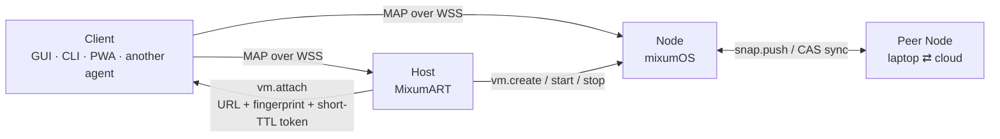

<div align="center">
  <h1>Mixum Agent Protocol</h1>
  <h3>MCP standardized the tools. MAP standardizes the world.</h3>
  <p>An open protocol that connects AI agents to isolated, snapshot-capable computing environments —<br/>the machine an agent lives in — across macOS, Windows, Linux, local laptops and cloud.</p>
  <p>
    <a href="https://github.com/EmergeShift/Mixum-Agent-Protocol"></a>
    <a href="LICENSE"></a>
    <a href="sdk/rust"></a>
    <a href="sdk/typescript"></a>
    <a href="schemas"></a>
    <a href="vectors"></a>
    <a href="CONTRIBUTING.md"></a>
  </p>
  <p><a href="README.zh-CN.md">简体中文</a> · <strong>English</strong></p>
</div>

> **Status: v1 Draft (alpha).** The wire surface is implemented and exercised by the [mixumOS](https://github.com/EmergeShift/mixumOS) reference Node and the [MixumART](https://github.com/EmergeShift/MixumART) client, but this is a draft, not a frozen standard. Memory/Host profiles, SDKs and parts of the prose are still moving. We publish early so implementers can push back before v1.0. The [stability markers](site/src/content/docs/spec/versioning-governance.md) say exactly what may still change.

---

## Alpha, honestly

MAP is a draft. The control plane works and two independent implementations talk
to each other, but the spec is not finished: memory and host profiles are not
frozen, the SDKs are skeletons, and some pages are ahead of the code.

We are a small team. The spec is the product, so it will keep changing until
v1.0 — that is the point of publishing it now. If something is underspecified or
wrong, open an issue or an RFC; disagreement is useful while it is still cheap.

## The missing layer

An agent that can only call tools is still trapped in someone else's sandbox.

MCP gave the ecosystem a standard way for an agent to call a **tool**. It did not standardize the thing the tool runs inside: a workspace with a filesystem, a task lifecycle, a desktop, a way to undo, and a way to move. Every sandbox vendor still invents a private API for the same five needs, so clients get locked to one backend and agents get locked to one runtime.

MAP is the contract for the other edge:

| Edge | Standard | What it carries |
|---|---|---|
| Agent ↔ tool | **MCP** | Function calls, resources, prompts |
| Agent ↔ environment | **MAP** | Tasks, snapshots, mobility, windows, memory |

They are complementary, not competing. An MCP server can run inside a MAP Node; a MAP Node can host any agent that speaks MAP-Bridge.

```text
        ┌──────────────┐        MCP         ┌──────────────┐
        │    Agent     │ ─────────────────▶ │    Tools     │
        └──────┬───────┘                    └──────────────┘
               │ MAP
        ┌──────▼───────────────────────────────────────────┐
        │  Node: tasks · snapshot tree · windows · memory  │
        │  VM or container on macOS / Windows / Linux      │
        └──────────────────────────────────────────────────┘
```

## What MAP standardizes

| Profile | Scope | v1 status |
|---|---|---|
| **MAP-Core** | Envelope & framing, session & system, tasks, snapshot-tree basics (create / restore / fork / delete / GC), MAP-Bridge presence | **Stable** |
| **MAP-Display** | `display.*`, per-window streaming, input, takeover state machine | **Stable** |
| **MAP-Mobility** | `snap.push` / pull, CAS sync, manifests, restore guards | **Stable** |
| **MAP-Memory** | `mem.*`, normalized records, providers, import/export | **Stable at v1.0** |
| **MAP-Host** | `vm.*`, images, VM lifecycle, bootstrap handoff | **Stable at v1.0** |
| MAP-Cluster | Multi-node scheduling through a Gateway | Reserved, not in v1 |

Conformance is scoped by profile. An implementation can claim *"MAP v1 Core + Display conformant"* without pretending to implement Memory or Host. Clients feature-probe the `profiles` and `caps` in `session.hello.ok`; they never guess from a version string.

## Design principles

1. **Capability-based security.** Every connection holds a least-privilege, ed25519-signed token. There is no ambient authority and no "logged-in user" — only capabilities.
2. **Content-addressed everything.** Snapshot chunks and manifests are addressed by the SHA-256 of their plaintext. Compression and encryption are storage details; deduplication is universal and hash verification is total.
3. **Event-sourced state.** Tasks and snapshot trees are observable event streams. Clients resync after reconnect; the server is the source of truth.
4. **Negotiated, additive evolution.** Versions are negotiated at hello. New ops, optional fields and codecs are minor; semantic or binary-layout changes are major and rare.
5. **Profiles, not a monolith.** MAP-Core plus optional profiles. Clients degrade gracefully when a profile is absent.
6. **Language-neutral wire.** JSON control plane plus tagged binary frames, locked by JSON Schemas and executable conformance vectors. SDKs are conveniences, never the definition.

## Roles and topology



| Role | Runs on | Serves | Must implement |
|---|---|---|---|
| **Node** | Inside a VM or container (Linux today) | `session`, `sys`, `task`, `snap`, `agent` (bridge), optional `display`, `mem` | MAP-Core |
| **Host** | Desktop: macOS / Windows / Linux | `vm.*`, images, bootstrap handoff, port forwarding | MAP-Host |
| **Client** | Anywhere | Consumes; initiates WSS connections | MAP-Core client side |
| **Peer** | Same as Node | Receives or sends `snap.push` | MAP-Mobility |
| **Gateway** | Cloud | Routing, multi-tenant auth | Reserved (not in v1) |

The Host is a control-plane convenience, never in the data path. Window frames and snapshot chunks travel directly between Client and Node, or Node and Peer.

## A 60-second session

```ts
import { MapClient } from "@mixum/map";

const client = await MapClient.connect({
  url: "wss://127.0.0.1:7601/ws",
  token: process.env.MAP_TOKEN!,     // map1.… bootstrap token
  // pinTLS: "sha256/…",             // TOFU wrapper is post-skeleton
});

const info = await client.sys.info();
console.log(info.server, info.profiles, info.arch, info.kernel);

const task = await client.task.submit({
  instruction: "Open a browser and search for MAP",
  agent: "external/claude-code",
  snapshotPolicy: { pre: "always", kind: "disk", onFailure: "rollback" },
});

client.task.onEvent((event) => {
  if (event.taskId === task.id) console.log(`[${event.type}]`, event.data);
});

const tree = await client.snap.tree();
console.log("head:", tree.head, "nodes:", tree.nodes.length);
```

Every control message is a small envelope; every reply points back to its request:

```json
{
  "v": 1,
  "id": "01JBV9C2…",
  "op": "task.submit",
  "seq": 42,
  "ts": 1696400000123,
  "payload": {
    "instruction": "Open a browser and search for MAP",
    "agent": "external/claude-code"
  }
}
```

The reply is `task.submit.ok` or `task.submit.err` with a stable error code (`bad_request`, `unauthorized`, `forbidden`, `not_found`, `conflict`, `unsupported`, `rate_limited`, `snapshot_invalid`, …). The exact shapes live in [`schemas/`](schemas).

## Tasks: a lifecycle, not a prompt

A task is one unit of agent work: instruction, agent, lifecycle, event stream, and a **guaranteed pre-task snapshot**.

```text
queued ──▶ running ──▶ completed
   │          │  │
   │          │  └──▶ suspended ──▶ running
   │          └────────▶ failed
   └────────────▶ canceled
```

- `task.submit` returns only after the pre-task snapshot exists (`preSnapNode`); the workspace can always be restored to that point.
- `snapshotPolicy.onFailure: "rollback"` restores to that node automatically when the task fails.
- Events (`state`, `log`, `step`, `progress`, `error`, `window`, `input`) are pushed as `task.event`, not polled.
- The **human-input channel** is standard: the agent asks via the bridge, observers get `task.event { type: "input" }`, any authorized client answers with `task.reply`, and the runner delivers `input.response` back to the agent. One request, one answer, with a timeout and a `sensitive` flag for secrets.

## Snapshots: git semantics for machine state

Every Node exposes a snapshot tree over its workspace, optionally over the task's process tree.

```text
20:00  n2 (pre-task)              main: genesis ── n1 ── n2 ── n3
22:00  n3
22:30  restore(n2, inplace) + work ── n4      ← parallel timeline
23:00  fork(n3, "aggressive-tuning")           ← new named branch
```

- A branch is an **attribute of nodes**; the head is a pointer. A new snapshot attaches under the current head.
- **In-place restore** moves the head back and materializes the workspace. Continuing work grows a parallel timeline; the old future is not deleted.
- **Fork** points a (new) branch at any node without touching the workspace.
- **Delete is leaf-only.** An interior node cannot be deleted, so a branch never loses its head through deletion and no dangling references exist.
- **GC** sweeps unreferenced chunks, with a 10-minute mtime window protecting concurrent pushes.

Snapshot kinds:

| Kind | Captures | Typical cost | Use |
|---|---|---|---|
| `disk` | Workspace filesystem | Milliseconds when hot | Pre-task points, save points |
| `memory` | Task process tree via CRIU | Seconds | Process migration / resume |
| `hybrid` | Both | Sum | Device handoff, full-state travel |

A pure `memory` snapshot must restore onto a matching disk state. A `memory`/`hybrid` snapshot whose `kernel` or `arch` differs is rejected with `snapshot_invalid` unless `force` bypasses the disk portion. Cross-kernel CRIU restore is deliberately unsupported in v1.

## Mobility: move the whole timeline

Mobility is peer-to-peer. The pushing Node is a MAP **client** of the receiving Node, using a dedicated `snap.sync` token.

```text
A → B  snap.push.import { node, manifests, chunks }
B → A  { missing: [hashes B does not have] }
A → B  binary chunk records (0x03 + SHA-256 + bytes)
A → B  snap.push.commit { count }
B → A  { node, stored: true }
```

- The receiver checks its CAS and asks only for what is missing. Re-pushing an already-synced node costs **zero bytes**.
- Every chunk is verified on arrival against the plaintext SHA-256.
- If the parent is absent, the incoming node becomes the root of a new **remote branch** with `origin` recorded. No cross-tree dangling references, ever.
- The whole flow is idempotent: a dropped connection can be retried without corrupting either tree.

This is what makes "close the laptop, continue in the cloud" a protocol operation rather than a migration script. The playbook is in [Mobility](site/src/content/docs/spec/mobility.md).

## Display: the agent's desktop, as native windows

MAP streams each window independently — clients attach per window, never to a whole screen.

```json
{
  "id": 7,
  "appId": "org.chromium.Chromium",
  "title": "bilibili — mixumOS",
  "width": 1280,
  "height": 800,
  "focused": false,
  "mode": "agent",
  "codec": "h264"
}
```

- `mode` is the takeover state: `agent` (task-owned, watch-only), `user` (claimed by a client), `free`.
- `jpeg` is mandatory for every MAP-Display implementation; `h264` is optional and negotiated. The attach reply's `codec` is authoritative; a Node without an encoder silently serves JPEG.
- Every video record carries a 27-byte header with window id, size, flags and **cursor position**, so the pointer is always consistent with the frame it came from.
- `codec: "png"` adds lossless, damage-based patches for local/LAN viewers. It is **Experimental** in v1: first frame full, then bounding-box patches, with a cursor-only format that does not touch the image.
- Input injection into an `agent` window replies `conflict`; claim it first. The takeover state machine forwards `suspend` to the agent and `resume` on release.

## Security model

- **Transport:** WebSocket over TLS 1.3 at `wss://host:port/ws`, subprotocol `map.v1`. Plaintext `ws://` exists in tests only.
- **Identity:** each Node generates an ed25519 key on first start. Its TLS certificate is self-signed ECDSA P-256; clients use **TOFU pinning** of the SHA-256 fingerprint. A mismatch is a hard disconnect, not a warning.
- **Authorization:** `map1.<payload>.<sig>` tokens, signed by the Node identity. Claims include `sub`, `caps`, `iat`, `exp`, `jti`, and optional bindings (`taskId`, `windows`, `mem.providers`).
- **Least privilege:** `admin` implies every capability but does not override bindings. A token bound to a `taskId` cannot submit new tasks.
- **Limits:** 32 MiB control frames, 16 MiB binary records, 50 messages/s with burst 100, 30 s heartbeat, ≥256-event resume ring, 2 s slow-consumer grace.
- **At rest:** optional AES-256-GCM per chunk; key = HKDF-SHA256(master, salt includes store id); AAD binds store id and plaintext chunk hash, preventing chunk transplant between stores.

| Capability | Grants |
|---|---|
| `task.run` | Submit and cancel tasks |
| `task.observe` | Subscribe to events, read tasks/snapshots/system info |
| `snap.manage` | Create, restore, fork, delete, GC |
| `snap.sync` | Receive pushed snapshots |
| `display.view` | List and attach windows |
| `display.input` | Inject input, takeover |
| `mem.read` / `mem.write` | Memory records |
| `vm.manage` | Host-side VM lifecycle |
| `admin` | Everything, still subject to bindings |

The full threat model, token issuance and encryption rules are in [Transport & Security](site/src/content/docs/spec/transport-security.md).

## Conformance: schemas + vectors, not vibes

The prose is normative for humans. These artifacts are normative for machines:

| Artifact | Locks |
|---|---|
| [`schemas/envelope.schema.json`](schemas/envelope.schema.json) | Control envelope (`v`, `id`, `op`, `seq`, `replyTo`, `ts`, `payload`) |
| [`schemas/token.schema.json`](schemas/token.schema.json) | `map1.` claims and bindings |
| [`schemas/task.schema.json`](schemas/task.schema.json) | Task object and events |
| [`schemas/snapshot-node.schema.json`](schemas/snapshot-node.schema.json) | Tree nodes |
| [`schemas/snapshot-manifest.schema.json`](schemas/snapshot-manifest.schema.json) | File inventory and chunks |
| [`schemas/memory-record.schema.json`](schemas/memory-record.schema.json) | Normalized memory records |
| [`schemas/bridge-message.schema.json`](schemas/bridge-message.schema.json) | Runner ↔ agent bridge messages |
| [`vectors/envelope/`](vectors/envelope) | Validation, reply conventions, error codes |
| [`vectors/snapshot-tree/`](vectors/snapshot-tree) | Restore-in-place timelines, fork numbering, leaf-only delete |
| [`vectors/bridge-session/`](vectors/bridge-session) | A full hello → exec → input → done transcript |

An implementation claims conformance **per profile** when it:

1. implements every op of that profile with the exact shapes in the schemas;
2. accepts every `valid` vector and rejects every `invalid` vector with the stated error code;
3. rejects everything it does not implement with `unsupported` instead of guessing.

Binary layouts (video frame header, chunk records, stdio records) are byte-exact in the spec chapters and intentionally not expressible as JSON Schema; the vectors and the Rust reference implementation lock them.

A community conformance runner is planned post-v1.0. False conformance claims are treated as a governance matter, not marketing.

## SDKs

Both SDKs are **skeletons** until v1.0: the wire types and client structure are here, but the spec is always the definition. That is deliberate — the schemas and vectors are the contract; SDKs are convenience.

| SDK | Package | Structure | First target |
|---|---|---|---|
| TypeScript | `@mixum/map` | `types.ts`, `errors.ts`, `ulid.ts`, `client.ts`; zero runtime dependencies (global WebSocket on Node ≥ 22 and browsers) | PWA, Node clients, MixumART |
| Rust | `map-core` | `types.rs`, `error.rs`, `token.rs`, `client.rs`; dependency-light default, `token-verify` and `client` features | mixumOS crates, CLIs, sync peers |

TypeScript:

```ts
import { MapClient } from "@mixum/map";

const client = await MapClient.connect({ url, token });
const tree = await client.snap.tree();
await client.snap.restore({ node: tree.head, strategy: "inplace" });
```

Rust:

```rust
use map_core::{Envelope, Task, SnapNode};

let request = Envelope::request("task.submit", serde_json::json!({
    "instruction": "…"
}));
```

Rust is a first-class target, not an afterthought: the reference Node's control plane and the Host's native side are Rust, and `map-core` is designed to compile in embedding targets without pulling a runtime it does not need. The TypeScript SDK ships the same wire types for browser and Node clients.

```bash
# Today: install from the repository.
npm install ./sdk/typescript
# When the v1.0 SDK release lands:
npm install @mixum/map
```

The `@mixum/map` npm package is not published during the skeleton phase.

## Reference implementations

| Project | Role | Conformance |
|---|---|---|
| [mixumOS](https://github.com/EmergeShift/mixumOS) | Arch-based agent OS; `mixum-agentd` + `mixcomp` are the reference **Node** | Core, Display, Mobility; Memory APIs implemented; Rust |
| [MixumART](https://github.com/EmergeShift/MixumART) | Desktop runtime manager, CLI, MCP; reference **Host** + Client | Host + Core client (reference; `vm.*` surface maturing); Rust + Tauri |
| **This repository** | Specification, JSON Schemas, vectors, TypeScript/Rust SDKs | — |

The reference Node's control plane is Rust end to end: tokio, `rustls`, `ed25519-dalek`, `zstd`, `sled`, a content-addressed snapshot engine and a CRIU driver. The compositor is C on wlroots, because that is where the Wayland ecosystem lives. That split matters for a protocol that parses untrusted manifests and moves multi-gigabyte trees — memory safety at the boundary is a feature of the contract, not an implementation detail.

## Repository map

```text
Mixum-Agent-Protocol/
├── site/            Astro Starlight docs — the normative spec lives here
├── schemas/         JSON Schema 2020-12, normative for machines
├── vectors/         Language-neutral conformance vectors
├── sdk/
│   ├── typescript/  @mixum/map — types, client, tests
│   └── rust/        map-core — types, token, client skeleton
├── rfcs/            RFC process and accepted proposals
├── GOVERNANCE.md    Maintainers, decision process, version ownership
├── CONTRIBUTING.md  The spec is the product; how to change it
├── CHANGELOG.md     Notable changes to the spec and artifacts
└── TRUST.md         Verifiable commitments: no phone-home, no lock-in
```

## Read and run the spec

- **Normative text:** [What is MAP?](site/src/content/docs/spec/overview.md) → [Quickstart](site/src/content/docs/quickstart.md) → [Tasks](site/src/content/docs/spec/tasks.md) → [Snapshots](site/src/content/docs/spec/snapshots.md).
- **Local site:**

```bash
cd site
npm install
npm run dev      # http://localhost:4321
npm run build    # production build, also the link/typo sanity pass
```

- **Chinese translations** of the overview and core concepts live under `site/src/content/docs/zh/`. The English text is normative.

## Versioning, RFCs and governance

- **v1 Draft** is the current state. `envelope.v` carries the major version; `session.hello.ok.versions` lists what a Node supports. Empty intersection closes the connection with `unsupported`.
- **Stable** means semantics are frozen within the major. **Stable at v1.0** means frozen when v1.0 ships; feedback now is the point. **Experimental** may change in minors and is excluded from conformance.
- Semantic changes go through an RFC in [`rfcs/`](rfcs) (Idea → Draft → Last Call → Accepted → Implemented). Typos and clarifications do not.
- **English is normative.** Translations must never invent semantics.
- Maintainers merge RFCs and cut spec releases; the capability/codec/error/profile registry is owned by the spec.

See [GOVERNANCE.md](GOVERNANCE.md) and [Versioning & Governance](site/src/content/docs/spec/versioning-governance.md).

## Non-goals (v1)

- **Multi-tenancy and public cloud routing.** The Gateway is reserved for a future version; v1 is single-user, multi-device.
- **Agent-to-agent conversations.** Use MCP or similar inside a Node; MAP carries the environment.
- **A specific agent framework.** MAP-Bridge is deliberately tiny so any framework can speak it in an afternoon.
- **Browser-side sandboxing.** Nodes run in VMs or containers on real hosts.
- **Cross-kernel CRIU.** v1 rejects memory/hybrid restores across kernel families instead of pretending portability.

## Roadmap

| Milestone | What ships |
|---|---|
| **v1.0 freeze** | Memory and Host profiles move from "Stable at v1.0" to Stable; token and crypto vectors land |
| **SDK releases** | `@mixum/map` on npm, `map-core` on crates.io, with a shared conformance harness |
| **Conformance runner** | A community runner that validates a Node against schemas + vectors + an egress check |
| **Registry** | A consolidated `REGISTRY.md` for capability strings, codecs, error codes and profiles |
| **Post-v1** | Gateway/Cluster profile, formalized damage-patch header, more platform importers |

## Contributing

The golden rule: **the spec is the product.** Every observable wire change lands as:

1. a spec chapter diff in `site/src/content/docs/spec/`;
2. a JSON Schema diff if a control-plane payload changed;
3. a conformance vector for new or tricky behavior;
4. a minor/major version decision.

For anything semantic, open an RFC first. Read [CONTRIBUTING.md](CONTRIBUTING.md) and [GOVERNANCE.md](GOVERNANCE.md). Good first issues are tagged `good first issue`; protocol questions are welcome as issues even when you are not proposing a change.

## Trust and license

MAP is [Apache-2.0](LICENSE). Contributions use DCO sign-off, not a CLA. The [TRUST commitments](TRUST.md) are part of the project, not marketing: no phone-home, credentials never transit Mixum infrastructure, content stays in the user's environment, telemetry (if any) lives only in the desktop app and is off by default, the gateway is open source and self-hostable, and portability is a right.

---

<div align="center">
  <sub>Tools are not a world. Give the agent a world it can undo.</sub>
</div>
