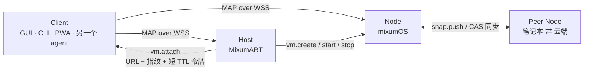

<div align="center">
  
  <h1>Mixum Agent Protocol</h1>
  <h3>MCP 让 agent 学会了调用工具。我们认为“环境”也需要一份契约——这是我们的草稿。</h3>
  <p>一个开放协议，把 AI agent 接到隔离、可快照的计算环境——<br/>agent 生活的那台机器——横跨 macOS、Windows、Linux、本地笔记本与云端。</p>
  <p>
    <a href="https://github.com/EmergeShift/Mixum-Agent-Protocol"></a>
    <a href="LICENSE"></a>
    <a href="sdk/rust"></a>
    <a href="sdk/typescript"></a>
    <a href="schemas"></a>
    <a href="vectors"></a>
    <a href="CONTRIBUTING.md"></a>
  </p>
  <p><strong>简体中文</strong> · <a href="README.md">English</a></p>
</div>

> 本文件是英文 README 的中文翻译。**规范正文以英文为准**；如中英文有冲突，以英文为准。
>
> **状态：v1 Draft（alpha）。** 线协议已由 [mixumOS](https://github.com/EmergeShift/mixumOS) 参考 Node 与 [MixumART](https://github.com/EmergeShift/MixumART) 客户端实现并实际跑通，但这是一份草稿，不是冻结的标准。Memory/Host profile、SDK 和部分正文仍在变化。我们提前发布，是希望在 v1.0 之前听到反对意见。[稳定性标记](site/src/content/docs/spec/versioning-governance.md)明确说明了哪些内容仍可能变化。

---

## 先说清楚：这是 alpha

MAP 是草稿。控制面能跑，两个独立实现也能互通，但规范还没完成：memory 和 host profile 没有冻结，SDK 还是骨架，部分文档跑在代码前面。

我们是一个小团队。规范就是产品，所以它在 v1.0 之前会一直变——这正是现在发布的理由。如果哪里定义不清或写错了，欢迎开 issue 或 RFC；在还便宜的时候提出反对，最有价值。

## 我们看到的缺口

只会调用工具的 agent，仍然被困在别人的沙箱里。

MCP 给了生态一个标准方式，让 agent 调用**工具**。但工具运行的那个东西——工作区、任务生命周期、桌面、撤销、迁移——仍没有共享契约。我们认为应该有。

MAP 是我们对这个契约的提案：

| 边 | 标准 | 承载什么 |
|---|---|---|
| Agent ↔ 工具 | **MCP** | 函数调用、资源、prompt |
| Agent ↔ 环境 | **MAP** | 任务、快照、迁移、窗口、记忆 |

它们互补，不竞争。MCP server 可以跑在 MAP Node 里；MAP Node 可以托管任何会说 MAP-Bridge 的 agent。

```text
        ┌──────────────┐        MCP         ┌──────────────┐
        │    Agent     │ ─────────────────▶ │    工具      │
        └──────┬───────┘                    └──────────────┘
               │ MAP
        ┌──────▼───────────────────────────────────────────┐
        │  Node：任务 · 快照树 · 窗口 · 记忆               │
        │  macOS / Windows / Linux 上的 VM 或容器          │
        └──────────────────────────────────────────────────┘
```

## MAP 想标准化什么

| Profile | 范围 | v1 状态 |
|---|---|---|
| **MAP-Core** | Envelope 与分帧、会话与系统、任务、快照树基础（创建 / 恢复 / fork / 删除 / GC）、MAP-Bridge 存在性 | **Stable** |
| **MAP-Display** | `display.*`、逐窗口流、输入、接管状态机 | **Stable** |
| **MAP-Mobility** | `snap.push` / pull、CAS 同步、清单、恢复守卫 | **Stable** |
| **MAP-Memory** | `mem.*`、归一化记录、provider、导入/导出 | **Stable at v1.0** |
| **MAP-Host** | `vm.*`、镜像、VM 生命周期、bootstrap 交接 | **Stable at v1.0** |
| MAP-Cluster | 通过 Gateway 的多节点调度 | 保留，不在 v1 |

一致性按 profile 声明。一个实现可以声称 *“MAP v1 Core + Display conformant”*，而不必假装实现了 Memory 或 Host。客户端探测 `session.hello.ok` 里的 `profiles` 与 `caps`，绝不从版本号猜测。

## 设计原则

1. **能力安全。** 每条连接持有 ed25519 签名的最小权限令牌。没有环境权限，也没有“已登录用户”——只有能力。
2. **一切内容寻址。** 快照块与清单按明文 SHA-256 寻址。压缩和加密只是存储细节；去重是普遍的，哈希校验是全量的。
3. **事件溯源状态。** 任务与快照树是可观察的事件流。客户端重连后重新同步；服务端是事实来源。
4. **协商式、增量演进。** 版本在 hello 时协商。新 op、可选字段、新 codec 是 minor；语义或二进制布局变化是 major，且很少发生。
5. **Profile，而不是单体。** MAP-Core 加可选 profile。profile 不存在时客户端优雅降级。
6. **语言中立的线格式。** JSON 控制面加带标签的二进制帧，由 JSON Schema 与可执行一致性向量锁定。SDK 是便利层，永远不是定义。

## 我们可能错在哪

我们不确定 profile 的切分对不对，不确定 memory 和 host 该不该放进 v1，也不确定能力令牌对多租户网关是否足够。草稿公开，就是为了让做过这些系统的人告诉我们漏了什么。

如果你实现过类似的沙箱 API、快照存储或令牌模型，一句直接的批评比一个 star 更有价值。欢迎开 issue 或 RFC。

## 角色与拓扑



| 角色 | 运行在 | 提供 | 必须实现 |
|---|---|---|---|
| **Node** | VM 或容器内（当前是 Linux） | `session`、`sys`、`task`、`snap`、`agent`（bridge），可选 `display`、`mem` | MAP-Core |
| **Host** | 桌面：macOS / Windows / Linux | `vm.*`、镜像、bootstrap 交接、端口转发 | MAP-Host |
| **Client** | 任意位置 | 消费；主动发起 WSS 连接 | MAP-Core 客户端侧 |
| **Peer** | 与 Node 相同 | 接收或发送 `snap.push` | MAP-Mobility |
| **Gateway** | 云端 | 路由、多租户鉴权 | 保留（不在 v1） |

Host 只是控制面便利层，永远不在数据路径上。窗口帧和快照块直接在 Client 与 Node、或 Node 与 Peer 之间传输。

## 一个 60 秒会话

```ts
import { MapClient } from "@mixum/map";

const client = await MapClient.connect({
  url: "wss://127.0.0.1:7601/ws",
  token: process.env.MAP_TOKEN!,     // map1.… bootstrap 令牌
  // pinTLS: "sha256/…",             // TOFU 包装属于骨架之后的工作
});

const info = await client.sys.info();
console.log(info.server, info.profiles, info.arch, info.kernel);

const task = await client.task.submit({
  instruction: "打开浏览器，搜索 MAP",
  agent: "external/claude-code",
  snapshotPolicy: { pre: "always", kind: "disk", onFailure: "rollback" },
});

client.task.onEvent((event) => {
  if (event.taskId === task.id) console.log(`[${event.type}]`, event.data);
});

const tree = await client.snap.tree();
console.log("head:", tree.head, "nodes:", tree.nodes.length);
```

每条控制消息都是一个小的 envelope；每个回复指回请求：

```json
{
  "v": 1,
  "id": "01JBV9C2…",
  "op": "task.submit",
  "seq": 42,
  "ts": 1696400000123,
  "payload": {
    "instruction": "打开浏览器，搜索 MAP",
    "agent": "external/claude-code"
  }
}
```

回复是 `task.submit.ok` 或 `task.submit.err`，带稳定错误码（`bad_request`、`unauthorized`、`forbidden`、`not_found`、`conflict`、`unsupported`、`rate_limited`、`snapshot_invalid` 等）。精确形状在 [`schemas/`](schemas)。

## 任务：有生命周期，不是一条 prompt

任务是 agent 工作的一个单元：指令、agent、生命周期、事件流，以及**有保证的前置快照**。

```text
queued ──▶ running ──▶ completed
   │          │  │
   │          │  └──▶ suspended ──▶ running
   │          └────────▶ failed
   └────────────▶ canceled
```

- `task.submit` 只有在前置快照存在后才返回（`preSnapNode`）；工作区永远可以恢复到打点状态。
- `snapshotPolicy.onFailure: "rollback"` 会在任务失败时自动恢复到该节点。
- 事件（`state`、`log`、`step`、`progress`、`error`、`window`、`input`）以 `task.event` 推送，不轮询。
- **人机输入通道**是标准的：agent 经 bridge 提问，观察者收到 `task.event { type: "input" }`，任何有权限的客户端用 `task.reply` 回答，runner 把 `input.response` 交回 agent。一问一答，带超时和用于秘密的 `sensitive` 标记。

## 快照：机器状态的 Git 语义

每个 Node 都暴露一棵工作区快照树，可选包含任务进程树。

```text
20:00  n2（前置）                 main: genesis ── n1 ── n2 ── n3
22:00  n3
22:30  restore(n2, inplace) 后继续工作 ── n4   ← 并行时间线
23:00  fork(n3, "aggressive-tuning")            ← 新命名分支
```

- 分支是**节点的属性**，head 是一个指针。新快照挂在当前 head 下。
- **原地恢复**把 head 移回去并物化工作区。继续工作会自然长出并行时间线；旧未来不会被删除。
- **Fork** 把任意节点指成一个（新）分支，不碰工作区。
- **只能删叶子。** 中间节点不可删，因此分支永远不会因删除而丢失 head，也不会出现悬空引用。
- **GC** 清扫不可达块，并用 10 分钟 mtime 窗口保护并发推送。

快照类型：

| 类型 | 捕获 | 典型成本 | 用途 |
|---|---|---|---|
| `disk` | 工作区文件系统 | 热路径毫秒级 | 前置点、保存点 |
| `memory` | 经 CRIU 捕获任务进程树 | 秒级 | 进程迁移/续跑 |
| `hybrid` | 两者 | 相加 | 设备交接、全状态迁移 |

纯 `memory` 快照必须恢复到匹配的磁盘状态。`kernel` 或 `arch` 不一致的 `memory`/`hybrid` 快照会以 `snapshot_invalid` 拒绝；`force` 只能绕过磁盘部分。v1 明确不支持跨内核 CRIU 恢复。

## 迁移：搬走整条时间线

迁移是点对点的。推送端 Node 是接收端 Node 的 MAP **客户端**，使用专门的 `snap.sync` 令牌。

```text
A → B  snap.push.import { node, manifests, chunks }
B → A  { missing: [B 没有的哈希] }
A → B  二进制块记录（0x03 + SHA-256 + 字节）
A → B  snap.push.commit { count }
B → A  { node, stored: true }
```

- 接收端检查自己的 CAS，只请求缺失的块。重推一个已同步节点是**零字节**。
- 每个块到达时都按明文 SHA-256 校验。
- 父节点不存在时，该节点成为新**远端分支**的根，并记录 `origin`。永远不产生跨树悬空引用。
- 整个流程幂等：断线后可以重试，不会破坏任何一棵树。

这就是为什么“合上笔记本，去云端继续”是一个协议操作，而不是迁移脚本。操作手册见 [Mobility](site/src/content/docs/spec/mobility.md)。

## 显示：agent 的桌面，以原生窗口呈现

MAP 逐窗口推流——客户端按窗口 attach，而不是订阅整块屏幕。

```json
{
  "id": 7,
  "appId": "org.chromium.Chromium",
  "title": "bilibili — mixumOS",
  "width": 1280,
  "height": 800,
  "focused": false,
  "mode": "agent",
  "codec": "h264"
}
```

- `mode` 是接管状态：`agent`（任务持有，只读）、`user`（客户端已认领）、`free`。
- 每个 MAP-Display 实现必须支持 `jpeg`；`h264` 可选并协商。attach 回复里的 `codec` 是权威结果；没有编码器的 Node 会静默降级为 JPEG。
- 每个视频记录带 27 字节头：窗口 id、尺寸、flags 和**光标位置**，因此指针永远与它所属的那一帧一致。
- `codec: "png"` 为本地/局域网观看者增加无损损伤补丁。它在 v1 中是 **Experimental**：首帧全量，之后只发脏区包围盒；cursor-only 格式只更新光标，不动图像。
- 向 `agent` 窗口注入输入会返回 `conflict`，必须先 claim。接管状态机会向 agent 转发 `suspend`，释放时转发 `resume`。

## 安全模型

- **传输：** WebSocket over TLS 1.3，`wss://host:port/ws`，子协议 `map.v1`。明文 `ws://` 只存在于测试。
- **身份：** 每个 Node 首次启动生成 ed25519 密钥。TLS 证书是自签 ECDSA P-256；客户端对 SHA-256 指纹做 **TOFU 固定**。不匹配是硬断连，不是警告。
- **授权：** `map1.<payload>.<sig>` 令牌，由 Node 身份签名。Claims 包括 `sub`、`caps`、`iat`、`exp`、`jti`，以及可选绑定（`taskId`、`windows`、`mem.providers`）。
- **最小权限：** `admin` 隐含所有能力，但不覆盖绑定。绑定了 `taskId` 的令牌不能提交新任务。
- **限制：** 控制帧 32 MiB，二进制记录 16 MiB，50 条/秒、突发 100，心跳 30 s，≥256 条事件恢复环，慢消费者 2 s 宽限。
- **静态数据：** 可选 AES-256-GCM 逐块加密；密钥 = HKDF-SHA256(master，salt 含 store id)；AAD 绑定 store id 与明文块哈希，防止块在 store 之间移植。

| 能力 | 授予 |
|---|---|
| `task.run` | 提交/取消任务 |
| `task.observe` | 订阅事件，读取任务/快照/系统信息 |
| `snap.manage` | 创建、恢复、fork、删除、GC |
| `snap.sync` | 接收推送的快照 |
| `display.view` | 列窗口、attach |
| `display.input` | 注入输入、接管 |
| `mem.read` / `mem.write` | 记忆记录 |
| `vm.manage` | 宿主侧 VM 生命周期 |
| `admin` | 全部，但仍受绑定约束 |

完整威胁模型、令牌签发与加密规则见 [Transport & Security](site/src/content/docs/spec/transport-security.md)。

## 一致性：靠 schema 和向量

正文对人来说是规范；这些产物对机器来说是规范：

| 产物 | 锁定什么 |
|---|---|
| [`schemas/envelope.schema.json`](schemas/envelope.schema.json) | 控制 envelope（`v`、`id`、`op`、`seq`、`replyTo`、`ts`、`payload`） |
| [`schemas/token.schema.json`](schemas/token.schema.json) | `map1.` claims 与绑定 |
| [`schemas/task.schema.json`](schemas/task.schema.json) | Task 对象与事件 |
| [`schemas/snapshot-node.schema.json`](schemas/snapshot-node.schema.json) | 树节点 |
| [`schemas/snapshot-manifest.schema.json`](schemas/snapshot-manifest.schema.json) | 文件清单与块 |
| [`schemas/memory-record.schema.json`](schemas/memory-record.schema.json) | 归一化记忆记录 |
| [`schemas/bridge-message.schema.json`](schemas/bridge-message.schema.json) | Runner ↔ agent bridge 消息 |
| [`vectors/envelope/`](vectors/envelope) | 校验、回复约定、错误码 |
| [`vectors/snapshot-tree/`](vectors/snapshot-tree) | 原地恢复时间线、fork 编号、仅删叶子 |
| [`vectors/bridge-session/`](vectors/bridge-session) | 完整 hello → exec → input → done 记录 |

一个实现**按 profile** 声称一致性，当它满足以下条件：

1. 用 schema 的精确形状实现该 profile 的每个 op；
2. 接受每个 `valid` 向量，并以声明的错误码拒绝每个 `invalid` 向量；
3. 对未实现的东西回 `unsupported`，而不是猜。

二进制布局（视频帧头、块记录、stdio 记录）在规范章节里字节级固定，故意不用 JSON Schema 表达；由向量与 Rust 参考实现锁定。

社区一致性 runner 计划在 v1.0 之后提供。虚假的一致性声明按治理问题处理，而不是营销问题。

## SDK

两个 SDK 在 v1.0 前都是**骨架**：线类型和客户端结构已经在了，但规范永远是定义。这是刻意的——schema 与向量才是契约，SDK 是便利层。

| SDK | 包 | 结构 | 首个目标 |
|---|---|---|---|
| TypeScript | `@mixum/map` | `types.ts`、`errors.ts`、`ulid.ts`、`client.ts`；除标准库外零运行时依赖（Node ≥ 22 与浏览器自带 WebSocket） | PWA、Node 客户端、MixumART |
| Rust | `map-core` | `types.rs`、`error.rs`、`token.rs`、`client.rs`；默认轻依赖，`token-verify` 与 `client` 特性 | mixumOS crate、CLI、同步对端 |

TypeScript：

```ts
import { MapClient } from "@mixum/map";

const client = await MapClient.connect({ url, token });
const tree = await client.snap.tree();
await client.snap.restore({ node: tree.head, strategy: "inplace" });
```

Rust：

```rust
use map_core::{Envelope, Task, SnapNode};

let request = Envelope::request("task.submit", serde_json::json!({
    "instruction": "…"
}));
```

Rust 是一等目标，不是事后补充：参考 Node 的控制面与 Host 的原生侧都是 Rust，`map-core` 被设计成能在嵌入目标里编译，而不会拉进它不需要的运行时。TypeScript SDK 提供同一套线类型，面向浏览器与 Node 客户端。

```bash
# 现在：从仓库安装。
npm install ./sdk/typescript
# v1.0 SDK 发布后：
npm install @mixum/map
```

骨架阶段 `@mixum/map` 尚未发布到 npm。

## 参考实现

| 项目 | 角色 | 一致性 |
|---|---|---|
| [mixumOS](https://github.com/EmergeShift/mixumOS) | 基于 Arch 的 agent OS；`mixum-agentd` + `mixcomp` 是参考 **Node** | Core、Display、Mobility；Memory API 已实现；Rust |
| [MixumART](https://github.com/EmergeShift/MixumART) | 桌面运行时管理器、CLI、MCP；参考 **Host** + Client | Host + Core client（参考实现；`vm.*` 面仍在成熟）；Rust + Tauri |
| **本仓库** | 规范、JSON Schema、向量、TypeScript/Rust SDK | — |

参考 Node 的控制面从里到外都是 Rust：tokio、`rustls`、`ed25519-dalek`、`zstd`、`sled`、内容寻址快照引擎和 CRIU 驱动。合成器是 wlroots 上的 C，因为 Wayland 生态就在那里。对一个要解析不可信清单、搬动数 GB 树的协议来说，这个分工很重要——边界上的 memory safety 是契约的一部分，不是实现细节。

## 仓库地图

```text
Mixum-Agent-Protocol/
├── site/            Astro Starlight 文档站——规范正文在这里
├── schemas/         JSON Schema 2020-12，对机器是规范
├── vectors/         语言中立的一致性向量
├── sdk/
│   ├── typescript/  @mixum/map——类型、客户端、测试
│   └── rust/        map-core——类型、令牌、客户端骨架
├── rfcs/            RFC 流程与已接受的提案
├── GOVERNANCE.md    维护者、决策流程、版本归属
├── CONTRIBUTING.md  规范就是产品，以及如何修改它
├── CHANGELOG.md     规范与产物的变更记录
└── TRUST.md         可验证承诺：不回传、不锁定
```

## 阅读与运行规范

- **规范正文：** [What is MAP?](site/src/content/docs/spec/overview.md) → [Quickstart](site/src/content/docs/quickstart.md) → [Tasks](site/src/content/docs/spec/tasks.md) → [Snapshots](site/src/content/docs/spec/snapshots.md)。
- **本地站点：**

```bash
cd site
npm install
npm run dev      # http://localhost:4321
npm run build    # 生产构建，同时做链接/错别字检查
```

- **中文翻译**位于 `site/src/content/docs/zh/`，覆盖概览与核心概念。规范以英文为准。

## 版本、RFC 与治理

- **v1 Draft** 是当前状态。`envelope.v` 携带主版本；`session.hello.ok.versions` 列出 Node 支持的主版本。交集为空则以 `unsupported` 关闭连接。
- **Stable** 表示在主版本内语义冻结。**Stable at v1.0** 表示 v1.0 发布时冻结；现在正是反馈窗口。**Experimental** 可能在 minor 中变化，且不计入一致性。
- 语义变更走 [`rfcs/`](rfcs) 的 RFC 流程（Idea → Draft → Last Call → Accepted → Implemented）。错别字和澄清不需要。
- **英文是规范语言。** 翻译不得发明语义。
- 维护者合并 RFC、发布规范版本；能力/codec/错误码/profile 注册表归规范所有。

见 [GOVERNANCE.md](GOVERNANCE.md) 与 [Versioning & Governance](site/src/content/docs/spec/versioning-governance.md)。

## 非目标（v1）

- **多租户与公网云路由。** Gateway 留给未来版本；v1 是单用户、多设备。
- **Agent 之间的对话。** 在 Node 内用 MCP 或类似协议；MAP 承载的是环境。
- **特定 agent 框架。** MAP-Bridge 刻意极小，任何框架都能在一个下午内接上。
- **浏览器侧沙箱。** Node 跑在真实宿主的 VM 或容器里。
- **跨内核 CRIU。** v1 直接拒绝跨内核家族的 memory/hybrid 恢复，而不是假装可移植。

## 路线图

| 里程碑 | 交付 |
|---|---|
| **v1.0 冻结** | Memory 与 Host 从 “Stable at v1.0” 转为 Stable；令牌与加密向量落地 |
| **SDK 发布** | `@mixum/map` 上 npm，`map-core` 上 crates.io，共用一致性 harness |
| **一致性 runner** | 社区 runner，按 schema + 向量 + 出站检查验证一个 Node |
| **注册表** | 统一的 `REGISTRY.md`，记录能力字符串、codec、错误码与 profile |
| **v1 之后** | Gateway/Cluster profile、损伤补丁头正式化、更多平台导入器 |

## 参与贡献

黄金法则：**规范就是产品。** 每一个可观察的线格式变更都要落成：

1. `site/src/content/docs/spec/` 里的规范章节 diff；
2. 控制面负载变化时的 JSON Schema diff；
3. 新行为或棘手行为的一致性向量；
4. minor/major 版本决策。

任何语义变更先开 RFC。阅读 [CONTRIBUTING.md](CONTRIBUTING.md) 与 [GOVERNANCE.md](GOVERNANCE.md)。适合入门的 issue 会打 `good first issue`；即使不准备提变更，协议问题也欢迎开 issue。

## 信任与许可

MAP 以 [Apache-2.0](LICENSE) 发布；schema、向量、SDK 与站点内容沿用同一许可。第三方组件遵循各自许可，见 [THIRD_PARTY_NOTICES.md](THIRD_PARTY_NOTICES.md)。贡献使用 DCO sign-off，而不是 CLA。[TRUST 承诺](TRUST.md)是项目的一部分，不是营销：不回传、凭据不经过 Mixum 基础设施、内容留在用户环境、遥测（如果有）只存在于桌面端且默认关闭、gateway 开源可自托管、可迁移性是一项权利。

---

<div align="center">
  <sub>工具不是世界。给 agent 一个可以撤销的世界。</sub>
</div>
